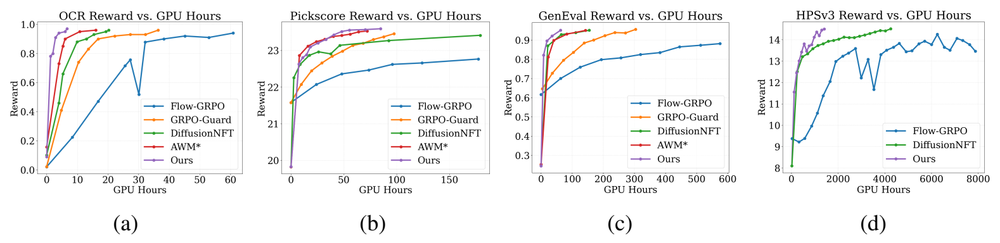
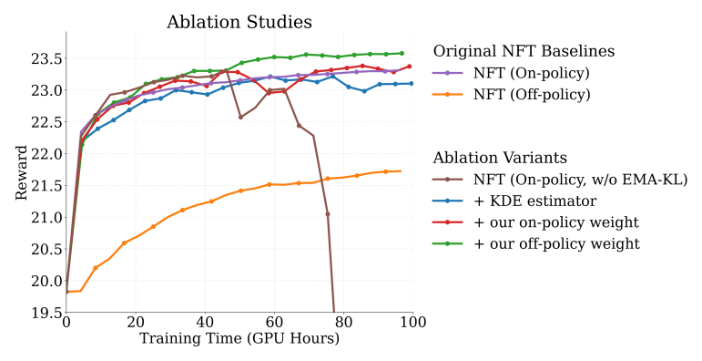

<h1 align="center">
Designing Reinforcement Learning for Diffusion Models:<br>
A Unified Path-Space View
</h1>

<p align="center">
<strong>Accepted to NeurIPS 2026</strong> · Official PyTorch Implementation
</p>

<div align="center">
  <a href="https://neurips.cc/">
    
  </a>
  <a href="https://arxiv.org/abs/2608.14430">
    
  </a>
  <a href="https://arxiv.org/pdf/2608.14430v1">
    
  </a>
  <a href="#citation">
    
  </a>
</div>

<p align="center">
Yixian Xu<sup>1*</sup> · Yuanrui Zhang<sup>1*</sup> · Shengjie Luo<sup>1†</sup> ·
Kaiyuan Gao<sup>2</sup> · Liwei Wang<sup>1</sup> · Di He<sup>1†</sup><br>
<sup>1</sup>State Key Laboratory of General Artificial Intelligence, School of Intelligence Science and Technology, Peking University<br>
<sup>2</sup>Huazhong University of Science and Technology<br>
<sup>*</sup>Equal contribution &nbsp;&nbsp; <sup>†</sup>Corresponding authors
</p>

## Overview

Reinforcement learning (RL) post-training for diffusion and flow-matching models is commonly divided into two seemingly unrelated families:

- **Reverse-trajectory methods** (e.g., Flow-GRPO, Dance-GRPO, TempFlow-GRPO, GRPO-Guard), which discretize the reverse-sampling SDE and optimize PPO-style Gaussian transition likelihood ratios along the denoising trajectory.
- **Forward-matching methods** (e.g., AWM, DiffusionNFT), which bypass reverse-time likelihoods and train on reward-labeled clean rollouts renoised along the forward path.

Our paper shows that both families arise from a **single continuous-time path-space principle**:

1. **Path-Space Importance Sampling & Variance Reduction (Sec. 3.1):** We prove an equivalent value-gradient representation ($\nabla_{x_t} V_t$), identifying the empirical gap between reverse-trajectory and forward-matching methods as a variance-reduction effect rather than a difference in RL principle.
2. **A Unified Design Space (Sec. 3.2):** Existing algorithms become special rows of a single template parameterized by the proposal dynamics $v_{\mathrm{base}}(\eta_t)$, the value-gradient estimator $\widehat{\nabla V}_t$, the off-policy regularizer weight $\hat{w}_1(A, t)$, the on-policy gradient weight $\hat{w}_2(t)$, and the sampler.
3. **Multi-Sample KDE Estimator & Scale-Bounded Weights (Sec. 3.3):** We introduce a KDE value-gradient estimator ($\widehat{\nabla V}^{\mathrm{KDE}}_t$) that reuses rollout groups without extra denoiser evaluations, paired with scale-bounded weight families $w_2(t) = t^{\alpha_2}$ (on-policy) and $w_1(t) = (1-t)^{\alpha_1}$ (off-policy) that rule out timestep singularities.

## Key Results

- **Direct Variance Reduction:** Under controlled evaluation on SD3.5-Medium, the stochastic one-sample estimator exhibits **13.8×** higher variance than the deterministic one-sample estimator; our matched KDE estimator ($h=1$) further reduces variance by **67.5%**.
- **Faster Training Convergence:**
  - On **SD3.5-Medium (OCR)**, our recipe converges **2× faster than AWM** and **3× faster than DiffusionNFT**, while saving **15.7% wall-clock time per epoch** over DiffusionNFT by avoiding an extra denoiser forward pass.
  - On **SD3.5-Medium (PickScore & GenEval)**, our recipe matches or exceeds strong baselines without requiring auxiliary EMA-KL teachers or complex solver schedules (~**3× faster** than full DiffusionNFT on PickScore).
  - On **Qwen-Image (HPSv3)**, our recipe achieves **4× faster convergence** than DiffusionNFT under matched 64-GPU configurations.

<p align="center">
  
  <br>
  <em><strong>Figure 3 (Sec. 4.3):</strong> Training efficiency comparison (Reward vs. GPU Hours) on <strong>SD3.5-Medium</strong> across (a) OCR, (b) PickScore, and (c) GenEval, and on <strong>Qwen-Image</strong> with (d) HPSv3 reward.</em>
</p>

<p align="center">
  
  <br>
  <em><strong>Figure 4 (Sec. 4.3):</strong> Component-wise ablation starting from DiffusionNFT without EMA-KL stabilization on SD3.5-Medium (PickScore). Combining our multi-sample KDE estimator with scale-bounded on-policy ($w_2$) and off-policy ($w_1$) weights stabilizes training and achieves ~3× faster convergence than full DiffusionNFT.</em>
</p>

## Paper-to-Code Mapping

The correspondence between the paper's notation and the configuration keys in `config/designed_recipes.py` is summarized below:

| Paper Concept                    | Paper Notation                                   | Config Key & Value                                                                     |
| -------------------------------- | ------------------------------------------------ | -------------------------------------------------------------------------------------- |
| Stochastic 1-sample estimator    | $\widehat{\nabla V}^{\mathrm{sto}}_t$            | `config.value_gradient_estimator = "sto_one_sample"`                                   |
| Deterministic 1-sample estimator | $\widehat{\nabla V}^{\mathrm{det}}_t$ (Prop. 3)  | `config.value_gradient_estimator = "det_one_sample"`                                   |
| Multi-sample KDE estimator       | $\widehat{\nabla V}^{\mathrm{KDE}}_t$ (Eq. 10)   | `config.value_gradient_estimator = "kde"`                                              |
| KDE kernel bandwidth $h$         | $h = d / m$ (Table 2)                            | `config.kde_bandwidth = d / m` (e.g., $d = 16 \times 64 \times 64$)                    |
| On-policy weight $w_2(t)$        | $w_2(t) = t^{\alpha_2}$                          | `config.policy_gradient_weight = "det_t_exp_a"`, `config.weight_exp` ($\alpha_2$)      |
| Off-policy weight $w_1(t)$       | $w_1(t) = (1 - t)^{\alpha_1}$                    | `config.off_policy_weight = "1_1t_exp_a"`, `config.off_policy_weight_exp` ($\alpha_1$) |
| Sampler noise schedule $\eta_t$  | $\eta_t = \sigma_{\mathrm{noise}}^2 / 2$ (Eq. 2) | `config.sample.noise_level` ($\sigma_{\mathrm{noise}}$)                                |
| KL regularization coefficient    | $\beta$ (Eq. 3)                                  | `config.train.beta`                                                                    |

## Supported Experiments

### Our Method & Estimator Ablations (`config/designed_recipes.py`)

| Model      | Reward    | Paper Section & Figure                                           | Training Entry                             | Config                                            |
| ---------- | --------- | ---------------------------------------------------------------- | ------------------------------------------ | ------------------------------------------------- |
| SD3.5-M    | PickScore | Sec. 4.3, Fig. 3(b) & Fig. 4 (Full KDE recipe)                   | `scripts/train_sd3_multi_estimator_kde.py` | `config/designed_recipes.py:sd3_pickscore_kde`          |
| SD3.5-M    | PickScore | Sec. 4.2, Fig. 2(c) & Sec. 4.3, Fig. 4 (On-policy KDE)           | `scripts/train_sd3_multi_estimator_kde.py` | `config/designed_recipes.py:sd3_pickscore_kde_onpolicy` |
| SD3.5-M    | PickScore | Sec. 4.2, Fig. 2(b, e) & Appx. G.1, Fig. 5(b) (Det. 1-sample)    | `scripts/train_sd3_multi_estimator_kde.py` | `config/designed_recipes.py:sd3_pickscore_det_w7_offw3` |
| SD3.5-M    | PickScore | Sec. 4.2, Fig. 2(a, d) (Stoch. 1-sample)                         | `scripts/train_sd3_multi_estimator_kde.py` | `config/designed_recipes.py:sd3_pickscore_sto_w1`       |
| SD3.5-M    | OCR       | Sec. 4.3, Fig. 3(a) (Full KDE recipe)                            | `scripts/train_sd3_multi_estimator_kde.py` | `config/designed_recipes.py:sd3_ocr_kde`                |
| SD3.5-M    | GenEval   | Sec. 4.3, Fig. 3(c) (Full KDE recipe)                            | `scripts/train_sd3_multi_estimator_kde.py` | `config/designed_recipes.py:sd3_geneval_kde`            |
| Qwen-Image | HPSv3     | Sec. 4.3, Fig. 3(d) (Full KDE recipe)                            | `scripts/train_qwenimage_kde.py`           | `config/designed_recipes.py:qwenimage_hpsv3_kde`        |

### Baselines

| Method                 | Training Entry                                                | Config File                               |
| ---------------------- | ------------------------------------------------------------- | ----------------------------------------- |
| Flow-GRPO              | `scripts/train_sd3.py` / `scripts/train_qwenimage.py`         | `config/grpo.py` / `config/designed_recipes.py` |
| DiffusionNFT (NFT)     | `scripts/train_sd3_nft.py` / `scripts/train_qwenimage_nft.py` | `config/nft.py` / `config/designed_recipes.py`  |
| GRPO-Guard (RatioNorm) | `scripts/train_sd3_GRPO_Guard.py`                             | `config/grpo_guard.py`                    |
| AWM                    | `scripts/train_sd3_awm.py`                                    | `config/awm.py`                           |

## Quick Start

### 1. Environment Setup

```bash
conda create -n diffusion-rl python=3.11 -y
conda activate diffusion-rl

python -m pip install --upgrade pip setuptools wheel
python -m pip install -e .
```

FlashAttention-2 is recommended for Qwen-Image and HPSv3:

```bash
python -m pip install flash-attn==2.7.4.post1 --no-build-isolation
```

### 2. Model Preparation

For multi-GPU or multi-node training, pre-downloading weights to local storage is recommended:

```bash
mkdir -p checkpoints

hf download stabilityai/stable-diffusion-3.5-medium \
  --local-dir checkpoints/stable-diffusion-3.5-medium
hf download Qwen/Qwen-Image \
  --local-dir checkpoints/Qwen-Image

export SD3_MODEL="$PWD/checkpoints/stable-diffusion-3.5-medium"
export QWEN_IMAGE_MODEL="$PWD/checkpoints/Qwen-Image"
```

### 3. Reward Preparation

#### PickScore

By default, `PickScoreScorer` loads:

- `laion/CLIP-ViT-H-14-laion2B-s32B-b79K`
- `yuvalkirstain/PickScore_v1`

For offline environments:

```bash
hf download laion/CLIP-ViT-H-14-laion2B-s32B-b79K \
  --local-dir checkpoints/CLIP-ViT-H-14-laion2B-s32B-b79K
hf download yuvalkirstain/PickScore_v1 \
  --local-dir checkpoints/PickScore_v1

export PICKSCORE_PROCESSOR_PATH="$PWD/checkpoints/CLIP-ViT-H-14-laion2B-s32B-b79K"
export PICKSCORE_MODEL_PATH="$PWD/checkpoints/PickScore_v1"
```

#### OCR

Install PaddlePaddle (matching your local CUDA version), PaddleOCR, and Levenshtein:

```bash
python -m pip install \
  paddlepaddle-gpu==2.6.2 \
  paddleocr==2.9.1 \
  python-Levenshtein
```

Pre-download the English OCR weights prior to distributed launches:

```bash
python - <<'PY'
from paddleocr import PaddleOCR
PaddleOCR(use_angle_cls=False, lang="en", use_gpu=False, show_log=False)
print("PaddleOCR models are ready.")
PY
```

#### GenEval

For local GenEval evaluation (`reward_backends="local"`), install MMCV 1.x, MMDetection 2.x, OpenCLIP, and CLIP Benchmark:

```bash
python -m pip install openmim open-clip-torch==2.31.0 clip-benchmark==1.6.1

git clone https://github.com/open-mmlab/mmcv.git third_party/mmcv
git -C third_party/mmcv checkout 1.x
MMCV_WITH_OPS=1 FORCE_CUDA=1 \
  python -m pip install -e third_party/mmcv -v --no-build-isolation

git clone https://github.com/open-mmlab/mmdetection.git third_party/mmdetection
git -C third_party/mmdetection checkout 2.x
python -m pip install -e third_party/mmdetection -v --no-build-isolation

mkdir -p reward_ckpts
wget \
  https://download.openmmlab.com/mmdetection/v2.0/mask2former/mask2former_swin-s-p4-w7-224_lsj_8x2_50e_coco/mask2former_swin-s-p4-w7-224_lsj_8x2_50e_coco_20220504_001756-743b7d99.pth \
  -P reward_ckpts/
```

On Hopper GPUs, pass `MMCV_CUDA_ARGS="-arch=sm_90"` when compiling MMCV. Alternatively, see [reward-server](https://github.com/yifan123/reward-server) for running GenEval as a standalone server (`reward_backends="remote"`).

#### HPSv3

Qwen-Image + HPSv3 training requires the official HPSv3 package, its checkpoint, and the `Qwen2-VL-7B-Instruct` base model:

```bash
git clone https://github.com/MizzenAI/HPSv3.git third_party/HPSv3
python -m pip install -e third_party/HPSv3

hf download MizzenAI/HPSv3 HPSv3.safetensors \
  --local-dir checkpoints/HPSv3
hf download Qwen/Qwen2-VL-7B-Instruct \
  --local-dir checkpoints/Qwen2-VL-7B-Instruct

export HPSV3_REPO="$PWD/third_party/HPSv3"
export HPSV3_CHECKPOINT="$PWD/checkpoints/HPSv3/HPSv3.safetensors"
export HPSV3_BASE_MODEL="$PWD/checkpoints/Qwen2-VL-7B-Instruct"
```

Optional environment variables: `HPSV3_CONFIG`, `HPSV3_DEVICE`, `HPSV3_USE_TRAINING_DEVICE`, and `HPSV3_ALLOW_HF_DOWNLOAD`.

## Training

### SD3.5-M + PickScore

The main SD3.5-M PickScore experiments run on 8 GPUs. Set a communication port and model path first:

```bash
export PORT="${PORT:-30000}"
export SD3_MODEL="${SD3_MODEL:-stabilityai/stable-diffusion-3.5-medium}"
```

**Our KDE & Value-Gradient Configurations**

```bash
# Final KDE recipe (off-policy), w2=t^3, w1=(1-t)^5, step-halving schedule [Sec. 4.3, Fig. 3(b) & Fig. 4]
accelerate launch \
  --config_file scripts/accelerate_configs/multi_gpu.yaml \
  --num_processes=8 --main_process_port="$PORT" \
  scripts/train_sd3_multi_estimator_kde.py \
  --config config/designed_recipes.py:sd3_pickscore_kde \
  --config.pretrained.model="$SD3_MODEL"

# KDE estimator (on-policy), w2=t^3, step-halving schedule [Sec. 4.2, Fig. 2(c) & Sec. 4.3, Fig. 4]
accelerate launch \
  --config_file scripts/accelerate_configs/multi_gpu.yaml \
  --num_processes=8 --main_process_port="$PORT" \
  scripts/train_sd3_multi_estimator_kde.py \
  --config config/designed_recipes.py:sd3_pickscore_kde_onpolicy \
  --config.pretrained.model="$SD3_MODEL"

# Deterministic 1-sample estimator (off-policy), w2=t^7, w1=(1-t)^3 [Sec. 4.2, Fig. 2(b, e)]
accelerate launch \
  --config_file scripts/accelerate_configs/multi_gpu.yaml \
  --num_processes=8 --main_process_port="$PORT" \
  scripts/train_sd3_multi_estimator_kde.py \
  --config config/designed_recipes.py:sd3_pickscore_det_w7_offw3 \
  --config.pretrained.model="$SD3_MODEL"

# Stochastic 1-sample estimator (off-policy), w2=t^1, w1=0 [Sec. 4.2, Fig. 2(a, d)]
accelerate launch \
  --config_file scripts/accelerate_configs/multi_gpu.yaml \
  --num_processes=8 --main_process_port="$PORT" \
  scripts/train_sd3_multi_estimator_kde.py \
  --config config/designed_recipes.py:sd3_pickscore_sto_w1 \
  --config.pretrained.model="$SD3_MODEL"
```

**Matched DiffusionNFT Configurations (Ablation & Comparison in Fig. 4)**

```bash
# DiffusionNFT reference configuration (on-policy with EMA-KL) [Sec. 4.3, Fig. 3(b) & Fig. 4]
accelerate launch \
  --config_file scripts/accelerate_configs/multi_gpu.yaml \
  --num_processes=8 --main_process_port="$PORT" \
  scripts/train_sd3_nft.py \
  --config config/nft.py:sd3_pickscore \
  --config.pretrained.model="$SD3_MODEL"

# DiffusionNFT off-policy configuration [Sec. 4.3, Fig. 4 "NFT (Off-policy)"]
accelerate launch \
  --config_file scripts/accelerate_configs/multi_gpu.yaml \
  --num_processes=8 --main_process_port="$PORT" \
  scripts/train_sd3_nft.py \
  --config config/nft.py:sd3_pickscore_off_policy \
  --config.pretrained.model="$SD3_MODEL"

# DiffusionNFT on-policy without EMA-KL decay [Sec. 4.3, Fig. 4 "NFT (On-policy, w/o EMA-KL)"]
accelerate launch \
  --config_file scripts/accelerate_configs/multi_gpu.yaml \
  --num_processes=8 --main_process_port="$PORT" \
  scripts/train_sd3_nft.py \
  --config config/nft.py:sd3_pickscore_on_policy \
  --config.pretrained.model="$SD3_MODEL"
```

### SD3.5-M + OCR

```bash
# Final KDE recipe on OCR [Sec. 4.3, Fig. 3(a)]
accelerate launch \
  --config_file scripts/accelerate_configs/multi_gpu.yaml \
  --num_processes=8 --main_process_port="$PORT" \
  scripts/train_sd3_multi_estimator_kde.py \
  --config config/designed_recipes.py:sd3_ocr_kde \
  --config.pretrained.model="$SD3_MODEL"
```

### SD3.5-M + GenEval

```bash
# Final KDE recipe on GenEval [Sec. 4.3, Fig. 3(c)]
accelerate launch \
  --config_file scripts/accelerate_configs/multi_gpu.yaml \
  --num_processes=8 --main_process_port="$PORT" \
  scripts/train_sd3_multi_estimator_kde.py \
  --config config/designed_recipes.py:sd3_geneval_kde \
  --config.pretrained.model="$SD3_MODEL"
```

### Qwen-Image + HPSv3

The Qwen-Image configs use 64 GPUs (e.g., 8 nodes × 8 GPUs per node):

```bash
export NNODES=8
export GPUS_PER_NODE=8
export NODE_RANK=<0-to-7>
export MASTER_ADDR=<master-hostname-or-ip>
export MASTER_PORT="${MASTER_PORT:-29500}"
```

**Our Method (KDE Estimator)**

```bash
# Final KDE recipe on Qwen-Image + HPSv3 [Sec. 4.3, Fig. 3(d)]
torchrun \
  --nnodes="$NNODES" --nproc-per-node="$GPUS_PER_NODE" \
  --node-rank="$NODE_RANK" \
  --master-addr="$MASTER_ADDR" --master-port="$MASTER_PORT" \
  scripts/train_qwenimage_kde.py \
  --config=config/designed_recipes.py:qwenimage_hpsv3_kde \
  --config.pretrained.model="$QWEN_IMAGE_MODEL"
```

**DiffusionNFT and Flow-GRPO Baselines**

```bash
# DiffusionNFT (64 GPUs) [Sec. 4.3, Fig. 3(d)]
torchrun \
  --nnodes="$NNODES" --nproc-per-node="$GPUS_PER_NODE" \
  --node-rank="$NODE_RANK" \
  --master-addr="$MASTER_ADDR" --master-port="$MASTER_PORT" \
  scripts/train_qwenimage_nft.py \
  --config=config/designed_recipes.py:qwenimage_hpsv3_nft \
  --config.pretrained.model="$QWEN_IMAGE_MODEL"

# Flow-GRPO (64 GPUs) [Sec. 4.3, Fig. 3(d)]
torchrun \
  --nnodes="$NNODES" --nproc-per-node="$GPUS_PER_NODE" \
  --node-rank="$NODE_RANK" \
  --master-addr="$MASTER_ADDR" --master-port="$MASTER_PORT" \
  scripts/train_qwenimage.py \
  --config=config/designed_recipes.py:qwenimage_hpsv3_grpo \
  --config.pretrained.model="$QWEN_IMAGE_MODEL"
```

## Baseline Reproduction (SD3.5-M)

Use the following template with the entries in the table below:

```bash
accelerate launch \
  --config_file scripts/accelerate_configs/multi_gpu.yaml \
  --num_processes=<GPUS> --main_process_port="$PORT" \
  <TRAIN_SCRIPT> \
  --config <CONFIG_FILE>:<CONFIG_NAME> \
  --config.pretrained.model="$SD3_MODEL"
```

| Method                           | Reward    | GPUs | Train Script                      | Config                                              |
| -------------------------------- | --------- | ---- | --------------------------------- | --------------------------------------------------- |
| DiffusionNFT (On-policy)         | PickScore | 8    | `scripts/train_sd3_nft.py`        | `config/nft.py:sd3_pickscore`                       |
| DiffusionNFT (Off-policy, Fig.4) | PickScore | 8    | `scripts/train_sd3_nft.py`        | `config/nft.py:sd3_pickscore_off_policy`            |
| DiffusionNFT (w/o EMA-KL, Fig.4) | PickScore | 8    | `scripts/train_sd3_nft.py`        | `config/nft.py:sd3_pickscore_on_policy`             |
| DiffusionNFT                     | OCR       | 8    | `scripts/train_sd3_nft.py`        | `config/nft.py:sd3_ocr`                             |
| DiffusionNFT                     | GenEval   | 8    | `scripts/train_sd3_nft.py`        | `config/nft.py:sd3_geneval`                         |
| Flow-GRPO    | PickScore | 8    | `scripts/train_sd3.py`            | `config/grpo.py:pickscore_sd3_8gpu`                 |
| Flow-GRPO    | OCR       | 32   | `scripts/train_sd3.py`            | `config/grpo.py:general_ocr_sd3`                    |
| Flow-GRPO    | GenEval   | 8    | `scripts/train_sd3.py`            | `config/grpo.py:geneval_sd3_8gpu`                   |
| GRPO-Guard   | PickScore | 8    | `scripts/train_sd3_GRPO_Guard.py` | `config/grpo_guard.py:pickscore_hps_sd3_ratio_norm` |
| GRPO-Guard   | OCR       | 16   | `scripts/train_sd3_GRPO_Guard.py` | `config/grpo_guard.py:general_ocr_sd3_rationorm`    |
| GRPO-Guard   | GenEval   | 16   | `scripts/train_sd3_GRPO_Guard.py` | `config/grpo_guard.py:geneval_sd3_rationorm`        |
| AWM          | PickScore | 8    | `scripts/train_sd3_awm.py`        | `config/awm.py:sd3_pickscore_1node`                 |
| AWM          | OCR       | 8    | `scripts/train_sd3_awm.py`        | `config/awm.py:sd3_ocr_1node`                       |
| AWM          | GenEval   | 8    | `scripts/train_sd3_awm.py`        | `config/awm.py:sd3_geneval_1node`                   |

## Acknowledgements

This repository builds upon [Flow-GRPO](https://github.com/yifan123/flow_grpo), [ddpo-pytorch](https://github.com/kvablack/ddpo-pytorch), and [Diffusers](https://github.com/huggingface/diffusers). We also thank the authors of [AWM](https://arxiv.org/abs/2509.25050), [DiffusionNFT](https://arxiv.org/abs/2509.16117), [GRPO-Guard](https://arxiv.org/abs/2510.22319), and [HPSv3](https://arxiv.org/abs/2508.03789).

## Citation

If you find this work or repository useful, please cite our paper:

```bibtex
@article{xu2026designing,
  title={Designing reinforcement learning for diffusion models: A unified path-space view},
  author={Xu, Yixian and Zhang, Yuanrui and Luo, Shengjie and Wang, Liwei and He, Di},
  journal={arXiv preprint arXiv:2608.14430},
  year={2026}
}
```

## License

This repository is released under the [MIT License](LICENSE). Pretrained diffusion models and reward checkpoints remain subject to their respective licenses and terms of use.
